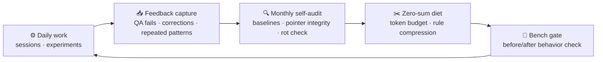

<h1>🐍 oh-my-ouroboros</h1>

<em>A Claude Code harness that devours its own output to grow.</em>

---

Like the mythic serpent coiled into a ring, this harness **feeds on its own output**: every session leaves feedback traces, a monthly audit consumes them, and the rules that emerge are forced through a hard token budget before they can live in context. It is not a plugin or a framework — it is a **sanitized one-way mirror of a real daily-driver `~/.claude`**, used across multiple servers for ML research and engineering.

> 🔒 Nothing here is hand-edited. A fail-closed export pipeline (allowlist → sanitize → forbidden-pattern gate → fresh-history sync) regenerates this repo on each release. Even the logo is code-generated — see [`assets/gen_ouroboros.py`](assets/gen_ouroboros.py).
>
> 🇰🇷 The rules and skills are written in **Korean** — this is a real production config, not a localized demo. The architecture, file layout, and this README are English; the patterns (budget hooks, audit loop, two-tier rules) read the same in any language.

## ✨ Why it's different

- 🧮 **Hard token budget with a zero-sum rule** — always-on context (`CLAUDE.md` + `rules/`) has a byte ceiling enforced by a commit hook. Adding a rule means shrinking another. The context never silently bloats.
- 🔍 **A self-audit loop with recorded baselines** — a monthly audit skill measures inventory drift, pointer integrity, doc/implementation mismatch, and *built-but-unused rot* against numbers written down last cycle. Fixes are classified (structural vs parameter) and hit-tracked next time.
- 🧾 **Evidence-gated "done"** — no success claims without verification output; subagent claims that change downstream actions are re-checked against `file:line` before adoption.
- 🧠 **Judgment rationale lives in artifacts** — trade-offs, failure-mode definitions, and tool-selection measurements are written into the rule/skill/script that embodies them, so any future session can reproduce the reasoning from files alone.
- 🛡️ **User sovereignty by construction** — pushes, deletions, training runs, and destructive writes are always user-executed; cross-session peer messages cannot escalate permissions; untrusted web content is quarantined to read-only agents.

## 🔄 The ouroboros loop

The tail feeds the mouth: waste found by the audit becomes the budget for the next rule.

## 🗂️ What's inside

| Layer | Contents |
|-------|----------|
| 📌 `CLAUDE.md` + `rules/` | Always-on tier: routing, model delegation (opus/sonnet/haiku), code-execution policy, memory triggers, prompt preprocessing |
| 💤 `rules-lazy/` | 40 lazy-loaded policies: QA process, context management, error handling, untrusted-content quarantine, secret handling, … |
| 🤖 `agents/` | 10 specialized subagents (scout · coder · qa · planner · researcher · searcher · docs · gitops · designer · citation-verifier) with spawn-prompt contracts |
| 🧰 `skills/` | 25 skills: experiment workflow, paper reading, multi-perspective discussion, harness audit & bench, wandb/checkpoint cleanup, cost breakdown, … |
| 🔩 `scripts/` | Hooks & automation: commit gates, session-start pattern mining, nightly ontology refresh, cost snapshots, this export pipeline |

## 🧪 Battle-tested details you won't find in most harnesses

- 📉 **Measured, not vibes** — a token-diet cycle found and removed ~3KB of *per-session* waste (stale index blocks, uncapped hook injections, over-verbose skill descriptions) because baselines made the growth visible.
- 🪤 **A catalog of defects that actually recur** — the audit greps first for the five patterns that have really bitten before: label/reality drift, catalog desync, hook cache isolation, MCP tool renames, and built-but-unused rot (including "trigger conditions no real utterance can reach").
- 🧹 **ML lifecycle cleanup gates** — after a training cycle: wandb run triage (3-tier tagging + workspace visibility) and checkpoint purge planning (KEEP/DELETE/HOLD matched against run states), destructive steps always user-executed.
- 🗃️ **Convention-based document format registry** — per-project Confluence/doc templates detected by directory existence, so any server or new project picks up the right format with no central table to maintain.
- 🖼️ **Media-preserving Confluence edits** — verbatim fetch → literal single-match substitution → node-count check, encoded as a rule after a real incident where full-body regeneration destroyed every image on a page.

## 🛠️ Using this

Read it as a **reference architecture**. The pieces most worth stealing:

1. ✂️ the zero-sum always-on budget hook (commit gate + byte ceiling),
2. 🔍 the audit skill and its baseline/history discipline,
3. 💤 the two-tier rule layout (always-on summary → lazy detail) with pointer-integrity checks,
4. 📋 the spawn-prompt 4-element contract (objective / output format / tools / task boundary).

Paths and identifiers are genericized; a few private layers (project knowledge, internal doc formats, personal memory) are intentionally absent, and some pointers to them are left dangling on purpose.

## 🤝 Feedback

Issues and PRs are welcome — they are reviewed, back-ported into the private source of truth, and re-published here. Derivatives are part of the loop too: if you build on this, link it in an issue. See [`CONTRIBUTING.md`](CONTRIBUTING.md).

## ⚖️ License

MIT — see [`LICENSE`](LICENSE).

🐍 The serpent renews itself by eating its own tail. So does this repo.

