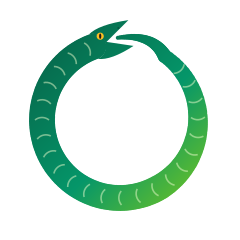
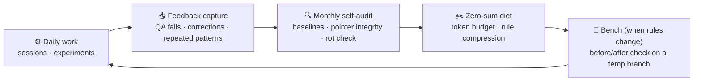

<h1>🐍 oh-my-ouroboros</h1>

<em>A Claude Code harness that devours its own output to grow.</em>

---

Like the mythic serpent coiled into a ring, this harness **feeds on its own output**: every session leaves feedback traces, a monthly audit consumes them, and the rules that emerge are weighed against a token budget before they can live in context. It is not a plugin or a framework — it is a **sanitized one-way mirror of a real daily-driver `~/.claude`**, used across multiple servers for ML research and engineering. Project-specific material (internal projects, documents, datasets, incident details) is removed on export; only the general-purpose harness is published.

> 🔒 Nothing here is hand-edited. A fail-closed export pipeline (allowlist → line/phrase removal → sanitize → syntax gate → forbidden-pattern gate → secret scan → fresh-history sync) regenerates this repo on each release. Even the logo is code-generated — see [`assets/gen_ouroboros.py`](assets/gen_ouroboros.py).
>
> 🇰🇷 The rules and skills are written in **Korean** — this is a real production config, not a localized demo. The architecture, file layout, and this README are English; the patterns (budget hooks, audit loop, two-tier rules) read the same in any language.

## ✨ Why it's different

- 🧮 **Token budget with a zero-sum habit** — always-on context (`CLAUDE.md` + `rules/`) has a byte ceiling that a commit hook checks on every commit. Going over it raises a warning rather than a block (a deliberate choice: losing a key rule sentence to fit the ceiling costs more), and the audit's diet cycle pays the overage back. The context never bloats silently.
- 🔍 **A self-audit loop with recorded baselines** — a monthly audit skill measures inventory drift, pointer integrity, doc/implementation mismatch, and *built-but-unused rot* against numbers written down last cycle. Fixes are classified (structural vs parameter) and hit-tracked next time.
- 🧾 **Evidence-gated "done"** — no success claims without verification output; subagent claims that change downstream actions are re-checked against `file:line` before adoption.
- 🧠 **Judgment rationale lives in artifacts** — trade-offs, failure-mode definitions, and tool-selection measurements are written into the rule/skill/script that embodies them, so any future session can reproduce the reasoning from files alone.
- 🧭 **Decisions as a UI, not a wall of text** — a decision-popup mod shows one decision at a time with a pros/cons table, an experiment summary table (what / how / why per run) and a concrete example per option. The tool refuses a call whose text names a run (by its run-name shape) without a row for it in that table, because a written rule alone was missed twice; aliases it cannot detect stay a pre-send check.
- ✍️ **Korean prose gates** — a style checker blocks inserted dashes and a dictionary of always-wrong spellings in Confluence publishes, and a Stop hook returns a final report with typos to be fixed before it reaches the user.
- 🛡️ **User sovereignty by construction** — pushes, pulls, and deploys are always user-executed, even when the user has just said yes (a hook blocks push and pull on approved commands too); data and environment changes run only after the user confirms in that turn; training runs only go up through a guarded launch set; cross-session peer messages cannot escalate permissions; untrusted web content is quarantined to read-only agents.

## 🔄 The ouroboros loop

The tail feeds the mouth: waste found by the audit becomes the budget for the next rule.

## 🗂️ What's inside

| Layer | Contents |
|-------|----------|
| 📌 `CLAUDE.md` + `rules/` | Always-on tier: routing, model delegation (opus/sonnet/haiku), code-execution policy, memory triggers, prompt preprocessing |
| 💤 `rules-lazy/` | 51 lazy-loaded policies: QA process, context management, error handling, untrusted-content quarantine, secret handling, decision sovereignty, … |
| 🤖 `agents/` | 12 specialized subagents (scout · coder · qa · security · reviewer · planner · researcher · searcher · docs · gitops · citation-verifier · tutor) with spawn-prompt contracts. Agents never call each other: main relays between them. Figures are made by main through the `figure` skill, not by an agent |
| 🧰 `skills/` | 33 skills: intent docs, experiment workflow, paper reading, multi-perspective discussion, harness audit & bench, weight-edit logging, wandb/checkpoint cleanup, cost breakdown, … |
| 🔩 `scripts/` | Hooks & automation: commit gates, session-start pattern mining, nightly ontology refresh, cost snapshots, this export pipeline |
| 🧩 `mods/` | Two Claude Code mods. `harness-mod` draws a band above the prompt: session and server status, training epochs, todos, a `/jira` group of your open issues (buttons only fill the prompt; posting stays behind preview and approval), a screen-only mask toggle for emails and tokens, and Mermaid blocks in replies drawn as ASCII. `decision-popup` is the decision tool described above |
| ⚙️ `settings.json` | The receipts: the actual hook wiring |

<b>🤖 The 12 agents, one line each</b>

 

| Agent | Model | Role |
|-------|-------|------|
| `scout` | haiku | Read-only recon — finds the files, symbols, and wiring before anyone edits |
| `coder` | sonnet | Implementation — writes and modifies code to spec |
| `qa` | sonnet | Verification — tests, call-site impact analysis, causal bug tracing |
| `security` | sonnet | Code vulnerability review (4 lenses) — runs alongside qa by default, same evidence bar |
| `reviewer` | opus | Depth-first code review, one function at a time — where the code drifts from its stated design |
| `planner` | opus | Architecture & experiment design consulting; final calls stay with main |
| `researcher` | opus | Paper writing, result analysis, adversarial design review |
| `searcher` | sonnet | The open-web search agent — returns summaries treated as untrusted data |
| `docs` | sonnet | Writes Confluence/Jira page drafts and comment bodies to files and returns the path; lookup, publishing, and recording stay with main |
| `gitops` | sonnet | Commits, branches, diffs, tags — push always stays with the human |
| `citation-verifier` | sonnet | Before a paper is cited: retraction lookup, then comparison of the quoted numbers and claims against the source text. A supporting/contrasting stance debate runs only for contested citations |
| `tutor` | opus | Teaches from finished artifacts: quiz → diagnose → re-explain → re-quiz until every answer is right |

<b>🧰 The 33 skills, one line each</b>

 

| Skill | What it does |
|-------|--------------|
| `solve` | Opinion/planning questions via a 5-step method; ambiguous execution requests get meta-prompt convergence |
| `discuss` | Multi-agent debate with a devil's advocate, persuasion-attack guards, and consensus-quality metrics |
| `experiment` | Experiment lifecycle: design → dry-run → launch → analysis → cleanup gates |
| `workflow` | Phase-based workflow design with auto-generated rubric gates |
| `harness-audit` | The monthly self-audit: baselines, pointer integrity, recurring-defect catalog |
| `harness-bench` | Before/after measurement tool for rule changes, run on a temporary branch before approval; self-reported; two benches are on record so far (the October 2026 audit and a fixed 24-question sheet from November 2026) |
| `learn-from-feedback` | Hooks log corrections and repeated patterns into a candidate ledger; 3+ hits become rule proposals the user accepts or rejects |
| `weight-edit` | Logs one no-retraining weight edit (pruning, quantization, targeted edits) as a procedure with a before-edit decision rule and a cumulative ledger with comparison tables; guarantees the record, not an accuracy gain |
| `intent` | Writes the "why" doc (problem, outcome, constraints, open questions, premises) before non-trivial work; feature commits must cite it |
| `paper-read` | 9-source parallel paper search + full-PDF close reading + review doc |
| `paper` | Paper writing: abstract, sections, review responses |
| `research` | Deep multi-source research with citation verification |
| `neuro-explain` | Neuroscience mechanism citations with mandatory plain-language analogies |
| `figure` | Paper figures: TikZ for structure, matplotlib for data; run by main (there is no figure agent) |
| `confluence` | Page format standards, macro-escaping lore, media-preserving edit protocol |
| `confluence-research-record` | 4-level research-note hierarchy (overview → year → month → day) |
| `storytelling` | But/therefore narrative structure for research records and talks |
| `dumbify` | Rewrites expert prose for non-expert readers without losing the numbers |
| `commit` | Commit conventions + a rejected-pattern check against feedback history |
| `wandb-cleanup` | 3-tier run triage + workspace visibility via raw GraphQL (no global hide API exists) |
| `ckpt-cleanup` | KEEP/DELETE/HOLD checkpoint classification against wandb run states; purge script is user-executed |
| `cost` | Per-model, per-agent cost breakdown rendered as a bar chart |
| `cost-reset` | Wipe accumulated cost ledgers (destructive, user-executed) |
| `graphify` | Turn any input into a persistent knowledge graph; query it before grepping |
| `project-init` | New research project scaffolding |
| `quick-skill` | Define a new rule/skill/agent quickly, with a write-time bloat gate |
| `setup-panels` | tmux panel layouts for teammate sessions |
| `grok` | Second opinions from Grok through an isolated wrapper, behind a send-level gate |
| `drawio-skill` | Editable draw.io diagrams (imported, MIT) |
| `experimental-design` | Study design before data: randomization, blocking, factorial layouts (imported, MIT) |
| `statistical-analysis` | Test selection, assumption checks, effect sizes, reporting (imported, MIT) |
| `statistical-power` | Sample-size and power calculations (imported, MIT) |
| `pydicom` | Reading and preflighting DICOM data safely, with bounded de-identification review (imported, MIT) |

## 🧪 Battle-tested details you won't find in most harnesses

- 📉 **Measured, not vibes** — every audit writes down always-on bytes and rule counts, so growth is visible from one cycle to the next and diet cycles have a baseline to beat.
- 🪤 **A catalog of defects that actually recur** — the audit greps first for nine patterns that have really bitten before, among them label/reality drift, catalog desync, hook cache isolation, MCP tool renames, built-but-unused rot (including "trigger conditions no real utterance can reach"), and one-sided symlink resolution in path guards.
- 🧹 **ML lifecycle cleanup gates** — after a training cycle: wandb run triage (3-tier tagging + workspace visibility) and checkpoint purge planning (KEEP/DELETE/HOLD matched against run states), destructive steps always user-executed.
- 🖼️ **Media-preserving Confluence edits** — verbatim fetch → literal single-match substitution → node-count check, encoded as a rule after a real incident where full-body regeneration destroyed every image on a page.

## 🛠️ Using this

Read it as a **reference architecture**. The pieces most worth stealing:

1. ✂️ the zero-sum always-on budget hook (commit gate + byte ceiling),
2. 🔍 the audit skill and its baseline/history discipline,
3. 💤 the two-tier rule layout (always-on summary → lazy detail) with pointer-integrity checks,
4. 📋 the spawn-prompt 4-element contract (objective / output format / tools / task boundary).

Paths and identifiers are genericized. Private layers are intentionally absent: project knowledge, internal document formats and the skeleton gate built on them, the audit history, and personal memory. Some pointers to them are left dangling on purpose; `scripts/confluence_patch_page.py` still expects that gate's stamp, so it refuses to apply edits in this mirror.

## 🤝 Feedback

Issues and PRs are welcome — they are reviewed, back-ported into the private source of truth, and re-published here. Derivatives are part of the loop too: if you build on this, link it in an issue. See [`CONTRIBUTING.md`](CONTRIBUTING.md).

## ⚖️ License

MIT — see [`LICENSE`](LICENSE).

🐍 The serpent renews itself by eating its own tail. So does this repo.

